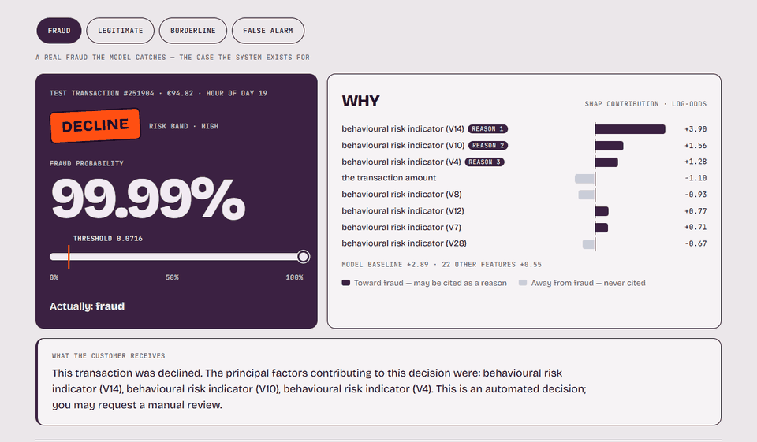
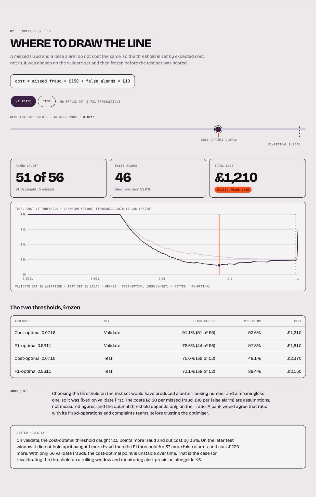
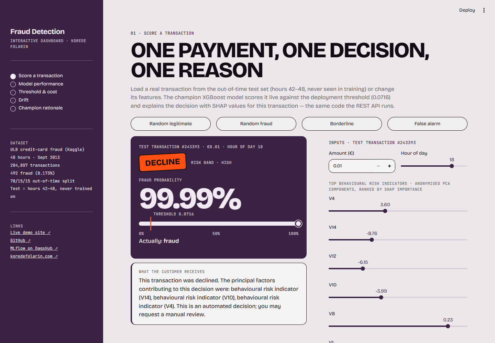
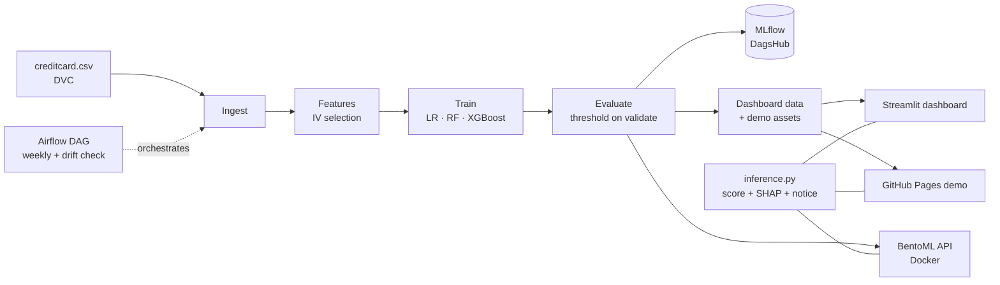
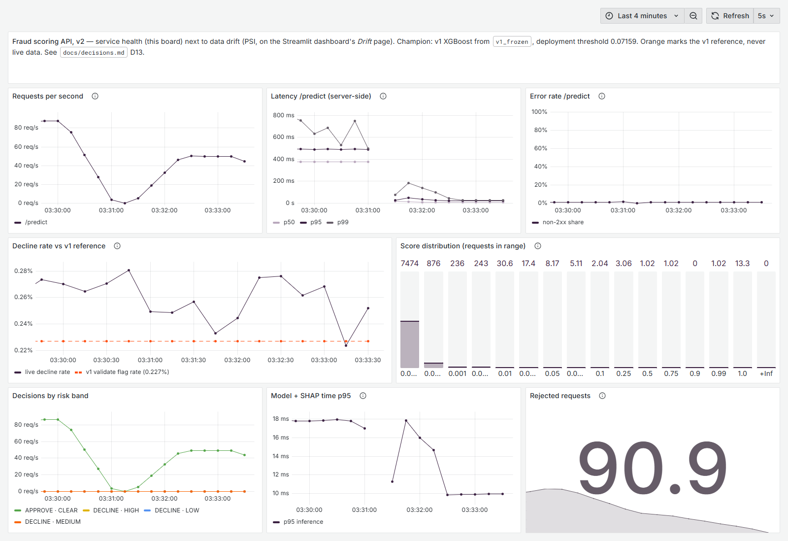

# Fraud Detection with Explainable Decisions

**A fraud model built to UK bank model-validation practice that tells every declined customer why, in plain English.**

[](https://github.com/korede-folarin/fraud-detection-ml/actions/workflows/ci.yml)
[](https://korede-folarin.github.io/fraud-detection-ml/)


### [▶ Open the live demo](https://korede-folarin.github.io/fraud-detection-ml/) &nbsp;·&nbsp; [Interactive dashboard](https://kf-fraud-detection-ml.streamlit.app) &nbsp;·&nbsp; [MLflow experiments](https://dagshub.com/korede-folarin/fraud-detection-ml.mlflow)

<a href="https://korede-folarin.github.io/fraud-detection-ml/"></a>

<sub>Four real transactions from the held-out last six hours of data, each with its decision, the SHAP reasons behind it, and the exact notice the customer receives. Every number is read from the pipeline's output files.</sub>

---

## The 30-second version

**The problem.** When a bank's model blocks a payment, the customer is rarely told why. The FCA's Consumer Duty expects communications customers can actually understand,[^1] and an unexplained decline is also a support call and a possible complaint.

**What I built.** An end-to-end fraud pipeline: ingestion, feature selection, three-model champion-challenger, cost-based threshold, a REST API that returns a **per-transaction reason for every decline**, monitoring, and two live front ends.

**How it performs.** These are results on the **out-of-time test set**: the final six hours of data, never used for training, tuning or picking the threshold.

| Fraud caught | Alert precision | Review load | KS / AUPRC |
|:---:|:---:|:---:|:---:|
| **75%** (39 of 52) | **48%** of alerts are real fraud | **19** per 10,000 payments | **0.805 / 0.760** |

**What is worth your time.** Not the score but the judgement calls:

1. I picked the model that **lost the leaderboard**, and the [evidence](#3-champion-the-leaderboard-winner-was-not-chosen) shows why.
2. My cost-optimal threshold **did not hold up on later data**. I [report that](#4-threshold-cost-not-f1-and-what-happened-out-of-time) rather than hide it.
3. The explanations are **honest about what they cannot tell a customer**: see [what the explanation can and cannot do](#explanations-a-reason-for-every-decline).

---

## What I did

This is a solo project, and I made every decision below.

- **Designed the validation:** a strict 70/15/15 split by time, so the test set is genuinely the future.
- **Selected features by Information Value** on the training set only, which exposed a U-shaped fraud pattern in transaction amount that correlation misses.
- **Trained and governed three models** (Logistic Regression, Random Forest, XGBoost) under identical conditions, and chose the champion by its behaviour at the deployment threshold.
- **Set the decision threshold by business cost** (£150 per missed fraud, £10 per false alarm) on the validate set, then froze it before scoring the test set.
- **Built the explanation layer:** SHAP values per transaction, turned into a customer notice. Unit tests enforce that only features pushing *towards* fraud are ever cited.
- **Shipped it:**
  - a BentoML REST API in Docker;
  - an Airflow DAG with a drift check;
  - MLflow on DagsHub and DVC;
  - a Streamlit dashboard and a static GitHub Pages demo;
  - CI that checks the demo's notices match the API's word for word.
- **Audited my own work.** I recomputed every headline number from the saved models, replaced a hard-coded threshold with one the pipeline derives, and removed every simulated chart.

---

## Five decisions and the evidence behind them

### 1. Validation: split by time, not at random

A random split lets the model train on the future, which inflates every metric. I trained on the earliest 70% of transactions, picked the threshold on the next 15%, and looked at the last 15% exactly once.

| Split | Hours | Transactions | Fraud rate |
|---|---|---|---|
| Train | 0 – 36.9 | 199,364 | 0.193% |
| Validate | 36.9 – 42.0 | 42,721 | 0.131% |
| Test | 42.0 – 48 | 42,722 | 0.122% |

The fraud rate fell by more than a third between train and test: real drift that a random split would have hidden. This is the out-of-sample discipline UK bank model-risk frameworks expect (PRA SS1/23).

### 2. Features: Information Value, not correlation

<details>
<summary><b>Correlation misses non-linear fraud patterns. IV, binned on the training set only, found a U-shape in amount.</b></summary>
<br>

| Amount (training set) | Fraud rate |
|---|---|
| below €1.19 | 0.67% |
| €1.19 – €237 | 0.11% |
| above €237 | 0.35% |

High fraud at tiny amounts is consistent with card testing, and at large amounts with account takeover. IV-based selection cut 34 candidate features to 30.

**Imbalance: `class_weight` over SMOTE.** There are 492 frauds against 284,315 legitimate payments. Synthetic frauds made up by interpolation don't exist in production, so I re-weighted inside each model instead (XGBoost `scale_pos_weight=518`). The payoff came later: XGBoost's mean score on validate (0.16%) sits close to the true fraud rate (0.13%).

**Velocity features: a data limit, measured.** Rolling 100-transaction features scored near-zero IV, because without customer IDs they mix different people's histories. In production these would be per-customer features from a feature store. IV quantified the gap rather than hiding it.

</details>

### 3. Champion: the leaderboard winner was not chosen

On the test set, Random Forest beats XGBoost on KS and AUPRC. But those metrics measure *ranking*, and a bank deploys a *threshold*. So I applied the same deployment threshold (0.0716) to all three models:

| Model | Test KS | Alert precision at threshold | Share of all payments flagged |
|---|---|---|---|
| Logistic Regression | 0.857 | 0.4% | **31.5%**, unusable |
| Random Forest | 0.843 | 8.1% | 1.3%, about 12 in 13 alerts false |
| **XGBoost (champion)** | 0.805 | **48.1%** | **0.19%** |

Random Forest's scores aren't calibrated: its mean score is 1.5% against a true rate of 0.13%. That makes a low threshold flood the review team.

<details>
<summary><b>How much weight this evidence can bear</b></summary>
<br>

With 52 test frauds, one case moves recall by 1.9 points. The KS and AUPRC gaps between models are small next to that noise; the precision gap at the threshold is not, and that is what the decision rests on.

**The fair challenge:** Random Forest's scores could be recalibrated (for example with isotonic regression) and might then compete. I haven't tested that. It is the first experiment I would run on the challenger, which stays registered.

Hyperparameters were set from domain knowledge rather than tuned. Standard cross-validation breaks time ordering, and tuning on a 48-hour window risks fitting its particular fraud bursts.

</details>

### 4. Threshold: cost, not F1, and what happened out of time

F1 treats a missed fraud and a false alarm as equally bad. Instead I minimised `cost = missed fraud × £150 + false alarms × £10` over every threshold on the validate set, then froze the result.

| Threshold (chosen on validate) | Validate: caught / precision / cost | Test: caught / precision / cost |
|---|---|---|
| Cost-optimal, 0.0716 | 91.1% / 52.6% / **£1,210** | 75.0% / 48.1% / £2,370 |
| F1-optimal, 0.9311 | 78.6% / 97.8% / £1,810 | 73.1% / 88.4% / **£2,150** |

**Stated honestly:** on validate, the cost-optimal threshold caught 12.5 points more fraud and cut cost by a third. **On the later test window it did not hold up.** It caught one more fraud for 37 more false alarms, and cost £220 more. With only 56 validate frauds, the optimum is unstable over time. That is the case for recalibrating on a rolling window and monitoring alert precision, not just KS.

<details>
<summary><b>See it on the live demo, and what the £ figures really are</b></summary>
<br>



The £150 and £10 are assumptions, not measured costs, and the optimal threshold depends only on their ratio. In a bank that ratio would be agreed with fraud operations and complaints teams before the optimiser's output is trusted.

</details>

### 5. Monitoring: KS alone would have missed it

The Airflow `drift_check` task flags retraining when test KS falls below 0.75; it's currently 0.805, so it reads healthy. But the Population Stability Index for V1 is 1.01, a large input shift, and section 4 shows the operating point had already broken. A production monitor should watch **PSI and alert precision alongside KS**. The dashboard tracks all three.

---

## Explanations: a reason for every decline

Every decline returned by the API (and both demos) includes:
- the fraud probability and risk band;
- the top SHAP contributions for *that* transaction;
- a plain-English notice naming the main factors;
- a statement that the decision was automated and can be reviewed.

Two rules are enforced by tests in [`tests/test_inference.py`](tests/test_inference.py):

1. **Only positive SHAP contributions are cited.** A feature that pushed a payment *away* from fraud is never given as a reason for blocking it.
2. **Honest naming.** V1–V28 are anonymised PCA components with no known meaning, so the notice calls them "behavioural risk indicators" instead of inventing a story. Only the engineered features (amount, time of day, spending volatility) are named concretely.

**What the explanation can and cannot do.** On this dataset a customer learns *that* a reason exists, not *what* it is. That is a limit of the data, not the method: with a bank's named features, the same code names them. An explanation also describes the model; it does not prove it right. A false alarm gets reasons that sound just as confident, which is why every notice offers a manual review.

<details>
<summary><b>Regulatory and commercial context</b></summary>
<br>

The UK has no direct equivalent of the US adverse action notice (ECOA / Regulation B). The Data (Use and Access) Act 2025 narrowed Article 22 UK GDPR protections around solely automated decisions. The FCA's Consumer Duty requires communications customers can understand, and consumer understanding remains a supervisory focus.[^2][^3]

This project does not claim UK regulation requires per-decision explanations today. It shows what a system designed ahead of that direction looks like.

Commercially, an unexplained decline generates contact-centre calls, and some escalate to the Financial Ombudsman Service, where firms pay a case fee regardless of outcome. A contemporaneous, per-transaction reason gives compliance an auditable record and gives customers less reason to escalate.

SHAP values come from XGBoost's native TreeSHAP (`pred_contribs`). It is exact, matches `shap.TreeExplainer` to floating-point precision, and needs no extra serving dependency.

</details>

---

## Two ways to explore it

| | |
|---|---|
| **[Live demo](https://korede-folarin.github.io/fraud-detection-ml/)** (GitHub Pages) | Always on, loads instantly. Replays four real test transactions and the threshold, champion and drift analysis. Nothing calls a model; a test checks its notices match the API word for word. |
| **[Interactive dashboard](https://kf-fraud-detection-ml.streamlit.app)** (Streamlit) | Scores transactions live. Edit amount, time of day and the top risk indicators and watch the decision flip, with a full SHAP waterfall. May take about 30 seconds to wake. |



---

## How it works



One scoring module, [`inference.py`](src/frauddetection/inference.py), is shared by the API, the dashboard and the demo-site build, so the three can't disagree.

**Stack:** Python · XGBoost · scikit-learn · SHAP · BentoML · Docker · Apache Airflow · MLflow (DagsHub) · DVC · Streamlit · GitHub Actions / Pages

<details>
<summary><b>Full results tables</b></summary>
<br>

All figures come from [`artifacts/model_evaluation/evaluation_results.json`](artifacts/model_evaluation/evaluation_results.json), written by the pipeline's evaluation stage.

**Validate set:** ranking metrics, with F1 at each model's own best threshold.

| Model | KS | AUPRC | F1 |
|---|---|---|---|
| XGBoost | 0.926 | 0.874 | 0.871 |
| Random Forest | 0.920 | 0.867 | 0.871 |
| Logistic Regression | 0.922 | 0.832 | 0.811 |

**Test set, out-of-time**

| Model | KS | AUPRC | F1 | Precision @ deployment threshold |
|---|---|---|---|---|
| **XGBoost (champion)** | 0.805 | 0.760 | 0.832 | **0.481** |
| Random Forest | 0.843 | 0.775 | 0.848 | 0.081 |
| Logistic Regression | 0.857 | 0.697 | 0.787 | 0.004 |

**Drift:** PSI from train to test is 1.01 for V1, 0.34 for V11 and 0.08 for V14. Fraud comes in bursts in low-volume hours; hour 26 is 54% higher than the same clock hour on day one.

</details>

---

## v2: production engineering, at zero cloud cost

v1 is frozen at tag `v1.0-evaluated`. A CI regression check recomputes all 181 v1 results from a committed, hash-checked bundle on every push, so v2 cannot change v1 by accident. Every v2 decision, including the failures, is in [`docs/decisions.md`](docs/decisions.md) (D8–D16). The step-by-step record is in [`CHANGELOG.md`](CHANGELOG.md).

| Component | Status | Real result |
|---|---|---|
| **CI**: lint (new code), tests, v1 regression, API Docker build + smoke test, Terraform plan | tested locally; first GitHub run on next push | 29 tests; coverage 25% (stated, not padded); v1 reproduced exactly on Windows and Linux |
| **Promotion gate** (none existed in v1) | tested locally | both v1 challengers lost: Random Forest had better precision (0.590 vs 0.526) but cost more (£1,390 vs £1,210). Logged to MLflow either way. |
| **Service monitoring**: Prometheus metrics + Grafana in Docker Compose | tested locally | p95 38 ms at 50 req/s; one worker saturates at about 80 req/s; 0 server errors; bad input now returns 400 (v1 returned 500) |
| **Streaming**: Kafka → PyFlink, with late and duplicate events, checkpoints, batched scoring | tested locally | 992 events/s at a 1,000/s target (p95 829 ms); about 2,500/s at 3× overload; **exact parity with v1 batch** in every run (0 decision flips), including after a forced restart |
| **AWS**: Terraform for ECR, ECS Fargate, S3, IAM with GitHub OIDC | **designed only, NOT deployed** | validate + offline plan pass (25 resources); about $25/month if deployed ([costs](v2/infra/README.md)) |
| Helm on kind | not done | skipped; it doesn't fit this machine's memory alongside the rest (D16) |



---

## What I'd do next

These are the honest limits of this version, in the order I'd tackle them.

1. **More time.** 48 hours and 52 test frauds give every test metric wide uncertainty. A real validation would use 12–24 months.
2. **Recalibrate Random Forest** and re-run the champion-challenger comparison.
3. **Rolling threshold recalibration**, with alert precision monitored next to KS and PSI.
4. **Time-series-aware hyperparameter tuning.**
5. **Per-customer velocity features** from a feature store, once customer IDs exist.

**Correction (v2, D10):** an earlier version of this README said scheduled retraining was "demonstrated, not exercised". In fact, the weekly DAG ran 48 times between June and November 2026. It ran inside an image with older library versions, so it produced a different model (test KS 0.836, not v1's 0.805), logged into the v1 experiment, with no promotion gate. It is now paused. Retraining resumes only behind the D11 gate, with the v1 library versions.

---

## Run it yourself

```bash
git clone https://github.com/korede-folarin/fraud-detection-ml
cd fraud-detection-ml
python -m venv venv
venv\Scripts\activate             # macOS/Linux: source venv/bin/activate
pip install -r requirements.txt && pip install -e .
```

**Dashboard only**, using the committed model and data, at http://localhost:8501:

```bash
pip install -r dashboard/requirements.txt
streamlit run dashboard/app.py
```

**Demo site**, at http://localhost:8600:

```bash
python -m http.server 8600 --directory site
```

<details>
<summary><b>Full pipeline, API, Docker and tests</b></summary>
<br>

Place `creditcard.csv` in `data/` (or `dvc pull`), then run the pipeline. MLflow logging to DagsHub happens only when `DAGSHUB_TOKEN` is set.

```bash
python main.py
python -m src.site.build          # refresh the demo site's data
```

Run the REST API, from the repository root (docs at http://localhost:3000):

```bash
python bento_service/save_model.py
bentoml serve bento_service.service:FraudDetectionService
```

Run it in Docker:

```bash
bentoml build -f bento_service/bentofile.yaml .
bentoml containerize fraud_detection:latest
docker run --rm -p 3000:3000 fraud_detection:latest
```

Run the tests:

```bash
pytest tests
```

**Repository layout**

```
src/frauddetection/   pipeline components, stage runners, inference.py (shared scoring)
dags/                 Airflow DAG: ingest → transform → train → evaluate → drift check
bento_service/        BentoML service and model registration
dashboard/            Streamlit app, committed model (XGBoost JSON) and demo sample
site/                 static GitHub Pages demo; data/ built by src/site/build.py
artifacts/            evaluation results, dashboard data, IV rankings
notebooks/            EDA, feature engineering, modelling and evaluation research
tests/                decision rules, SHAP additivity, site matches API
```

</details>

**Dataset:** [ULB Credit Card Fraud](https://www.kaggle.com/datasets/mlg-ulb/creditcardfraud). It covers two days of European card transactions from September 2013, with amounts in euros. The £ costs are illustrative business inputs.

---

**Korede Folarin.** I build ML systems that hold up in regulated settings. See more at [koredefolarin.com](https://koredefolarin.com) or on [GitHub](https://github.com/korede-folarin).

[^1]: FCA Consumer Duty, consumer understanding outcome (PRIN 2A.5): communications should "meet the information needs of retail customers," "are likely to be understood," and "equip retail customers to make decisions that are effective, timely and properly informed." Summary: https://www.hoganlovells.com/en/publications/consumer-duty-navigating-the-consumer-understanding-outcome

[^2]: FCA, Our Consumer Duty focus areas: https://www.fca.org.uk/publications/corporate-documents/consumer-duty-focus-areas

[^3]: FCA, Consumer understanding: good practice and areas for improvement (March 2026): https://www.fca.org.uk/publications/good-and-poor-practice/consumer-understanding-good-practice-areas-improvement
